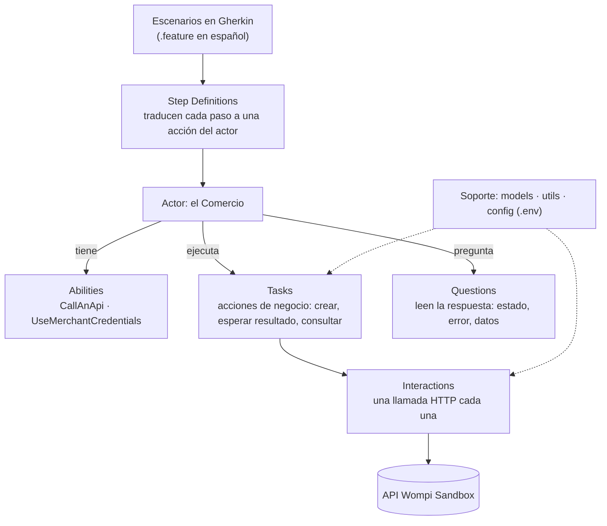

# REVIEW — Reto de Automatización Wompi

Este documento explica cómo construí el framework de pruebas automatizadas para las transacciones de **Nequi** en Wompi: cómo está organizado, por qué tomé cada decisión, qué escenarios diseñé y cómo usé la inteligencia artificial durante el desarrollo.

---

## 1. Cómo abordé el reto

Antes de escribir código quise entender cómo se comporta realmente el API. Por eso el trabajo siguió este orden:

1. **Exploración del API.** Hice llamadas manuales al sandbox para confirmar que las llaves funcionaban y para observar cómo responde Wompi en casos exitosos y de error. De ahí salieron varios hallazgos que cambiaron el diseño (ver sección 6).
2. **Estructura del proyecto y variables de entorno.** Organicé el proyecto y dejé las llaves fuera del código desde el primer momento.
3. **Escenarios primero.** Escribí los escenarios en lenguaje de negocio (Gherkin, en español) **antes** que el código, porque el reto pide BDD y en BDD el comportamiento esperado guía la implementación, no al revés.
4. **Implementación con el patrón Screenplay**, construyendo solo lo que los escenarios necesitaban.
5. **Validación**: ejecuté las pruebas contra el sandbox y comprobé que realmente detectan fallas.

### ¿Por qué Nequi?

De los medios de pago disponibles (excepto tarjeta de credito), elegí **Nequi** porque:

- Es uno de los medios de pago más usados en Colombia.
- En el sandbox tiene números de prueba con resultados predecibles: uno que aprueba, otro que declina y otro que termina en error. Esto permite probar el flujo completo de forma confiable.
- Su flujo es asíncrono (la transacción nace en `PENDING` y luego cambia de estado), lo que representa un reto real de automatización: esperar el resultado final sin depender de pausas fijas.

---

## 2. Arquitectura del framework

El framework está organizado en capas. Cada capa tiene una sola responsabilidad y solo conoce a la capa que está debajo de ella.



| Capa | Qué hace | Ejemplos |
|---|---|---|
| **Features** | Describen el comportamiento esperado en lenguaje de negocio | `01_creacion_transaccion_nequi.feature` |
| **Step Definitions** | Conectan cada frase del escenario con una acción del actor. No tienen lógica | `TransactionCreationStepDefinitions` |
| **Abilities** | Lo que el actor *puede* hacer: llamar al API y usar sus llaves | `CallAnApi`, `UseMerchantCredentials` |
| **Tasks** | Acciones de negocio, compuestas por varias interacciones | `CreateNequiTransaction`, `WaitForTheFinalStatus` |
| **Interactions** | Una sola llamada HTTP al API | `PostTransaction`, `GetTransaction`, `GetMerchant` |
| **Questions** | Lo que el actor *observa* en la respuesta | `TheTransaction.status()`, `TheError.messagesOf(...)` |
| **Soporte** | Modelos del request, firma SHA-256, configuración y datos de prueba | `IntegritySignature`, `WompiConfig` |

### Estructura de carpetas

```
src/
├── main/java/co/wompi/automation/
│   ├── abilities/      → credenciales del comercio
│   ├── config/         → lectura de variables de entorno (.env)
│   ├── interactions/   → llamadas HTTP al API
│   ├── models/         → estructura de los datos enviados y recibidos
│   ├── questions/      → consultas sobre las respuestas
│   ├── tasks/          → acciones de negocio
│   └── utils/          → firma de integridad, datos de prueba
└── test/
    ├── java/co/wompi/automation/
    │   ├── hooks/            → prepara un escenario limpio antes de cada prueba
    │   ├── runners/          → punto de entrada de la ejecución
    │   └── stepdefinitions/  → pegamento entre Gherkin y Screenplay
    └── resources/features/nequi/  → escenarios en Gherkin
```

### Tecnologías

| Herramienta | Uso |
|---|---|
| **Java 21 (LTS)** | Lenguaje, cumpliendo el requisito de versión LTS |
| **Gradle** (con wrapper) | Construcción y ejecución; no requiere instalar Gradle |
| **Serenity BDD + Screenplay** | Implementación del patrón y reportes |
| **Cucumber** | Escenarios BDD en Gherkin |
| **REST Assured** (vía Serenity) | Llamadas HTTP al API |
| **Awaitility** | Espera inteligente del estado final de la transacción |
| **dotenv-java** | Lectura del archivo `.env` |

---

## 3. Patrón de diseño: Screenplay

### ¿Qué es?

Screenplay modela la prueba como lo que hace **una persona (actor)** para cumplir un objetivo. En este caso el actor es **el Comercio**, que:

- **Tiene habilidades** (*Abilities*): puede llamar al API de Wompi y usar sus llaves.
- **Realiza tareas** (*Tasks*): crear una transacción, esperar su resultado, consultarla.
- **Hace preguntas** (*Questions*): ¿en qué estado quedó la transacción?, ¿qué error devolvió Wompi?

### ¿Por qué lo elegí?

1. **Encaja naturalmente con BDD.** Un paso como *"Cuando el comercio crea una transacción de 25000 pesos al número Nequi..."* se traduce casi literalmente en código: `actor.attemptsTo(CreateNequiTransaction.withValidData(25000, "3991111111"))`. El escenario y el código hablan el mismo idioma.
2. **Reutilización real.** La tarea que crea una transacción se usa en la creación, en el resultado y en la consulta. Las variantes negativas (sin token, firma inválida) son variaciones de la misma tarea, no código duplicado.
3. **Fácil de mantener.** Si Wompi cambia un endpoint, solo se modifica la *Interaction* correspondiente; los escenarios y las tareas no se tocan.
4. **Fácil de extender.** Agregar otro medio de pago (por ejemplo PSE) significa crear una nueva tarea, reutilizando las interacciones, preguntas y configuración existentes.


---

## 4. Escenarios de prueba

### Cómo los clasifiqué

- **Positivo:** el flujo feliz; el comercio cumple su objetivo.
- **Alterno:** un flujo válido en el que el negocio obtiene un resultado distinto pero legítimo (por ejemplo, el cliente rechaza el pago).
- **Negativo:** una solicitud inválida o no autorizada que el sistema debe rechazar.

**Relación con lo que pide el reto:** el enunciado habla de escenarios *exitosos* y *alternos*. Los **exitosos** corresponden a mis escenarios **positivos**, y los **alternos** del reto incluyen tanto mis **alternos** (resultados de negocio distintos) como mis **negativos** (rechazos). Preferí separarlos porque no es lo mismo que un cliente decline un pago, algo normal en el negocio, a que el sistema rechace una solicitud mal formada.

### Cómo los seleccioné

Durante la exploración identifiqué **24 escenarios**, todos verificados manualmente contra el sandbox. No todos aportan el mismo valor, así que prioricé **8 para automatizar**, eligiendo los de mayor impacto para el negocio: crear, completar y consultar una transacción, más los controles de seguridad más importantes. Los demás quedan documentados como candidatos para una siguiente iteración.

### 4.1 Escenarios automatizados (8)

| ID | Tipo | Escenario | Resultado esperado | ¿Por qué es crítico? |
|---|---|---|---|---|
| CP-01 | Positivo | Crear transacción Nequi con datos válidos | Se crea en `PENDING`, con ID asignado y los mismos datos enviados | Es la puerta de entrada de todo el flujo de pago |
| CP-05 | Positivo | Completar transacción Nequi con resultado aprobado | Finaliza en `APPROVED` con fecha de finalización | Es lo que le importa al negocio: el pago se cobra |
| CP-07 | Positivo | Consultar una transacción existente por ID | Retorna la transacción con sus datos correctos | Permite al comercio conciliar sus pagos |
| CP-06 | Alterno | Completar transacción Nequi con resultado declinado | Finaliza en `DECLINED` con el mensaje del rechazo | El comercio no debe entregar el producto si el cliente rechaza |
| CP-02 | Negativo | Crear transacción sin acceptance_token | Rechazo 422: `acceptance_token` no está presente | Aceptar términos y condiciones es un requisito legal |
| CP-03 | Negativo | Crear transacción sin datos obligatorios | Rechazo 422: monto, moneda y referencia no presentes | Evita transacciones incompletas |
| CP-04 | Negativo | Crear transacción con firma de integridad inválida | Rechazo 422: "La firma es inválida" | Protege contra cobros alterados o falsificados |
| CP-08 | Negativo | Utilizar una credencial privada inválida | Rechazo 401: "Llave no válida" | Impide que terceros accedan a las transacciones del comercio |

Los escenarios están en `src/test/resources/features/nequi/`, agrupados en tres archivos: **creación**, **resultado** y **consulta**.

### 4.2 Escenarios diseñados, verificados y no automatizados (16)

Todos fueron probados manualmente contra el sandbox durante la exploración, por lo que su resultado esperado es real.

| # | Tipo | Escenario | Resultado observado en sandbox |
|---|---|---|---|
| 1 | Positivo | Completar transacción aprobada con el monto mínimo ($1.500) | `APPROVED` |
| 2 | Positivo | Consultar transacciones por referencia con la llave privada | 200, retorna la transacción |
| 3 | Alterno | Completar transacción con número no registrado en Nequi (`3001234567`) | `ERROR`: "Número no válido en Sandbox" |
| 4 | Negativo | Consultar una transacción inexistente | 404: "La entidad solicitada no existe" |
| 5 | Negativo | Crear transacción sin método de pago | 422: "No se especificó método de pago o fuente de pago" |
| 6 | Negativo | Monto inferior al mínimo ($1.499) | 422: "El monto mínimo de una transacción es $1,500" |
| 7 | Negativo | Moneda no soportada (USD) | 422: "Debe ser uno de estos: COP" |
| 8 | Negativo | Número Nequi con menos de 10 dígitos | 422: "El tamaño no puede ser menor que 10" |
| 9 | Negativo | Número Nequi con más de 10 dígitos | 422: "El tamaño no puede ser mayor que 10" |
| 10 | Negativo | Correo del cliente inválido | 422: "Email inválido" |
| 11 | Negativo | Monto alterado después de firmar la transacción | 422: "La firma es inválida" |
| 12 | Negativo | Reutilizar la referencia de otra transacción | 422: "La referencia ya ha sido usada" |
| 13 | Negativo | Reutilizar un acceptance_token ya usado | 422: "El token de aceptación ya fue usado" |
| 14 | Negativo | acceptance_token con formato incorrecto | 422: "El token de aceptación está en un formato incorrecto" |
| 15 | Negativo | Crear transacción sin enviar la llave del comercio | 401: "Se esperaba una llave pública o privada" |
| 16 | Negativo | Usar la llave pública en un endpoint que exige la privada | 401: "Solicitud no autorizada" |

**Criterio para dejarlos fuera:** varios son validaciones de formato con menor riesgo (6 al 10) o repiten un control ya cubierto (11 refuerza lo que valida CP-04; 15 y 16 son variantes de CP-08). Son buenos candidatos para una segunda iteración, y el framework ya tiene casi todo lo necesario para automatizarlos con pocos cambios.

---

## 5. Decisiones técnicas

| Decisión | Por qué |
|---|---|
| **Escenarios antes que código** | Es la esencia de BDD: el comportamiento esperado define qué se construye. Así evité crear clases que ningún escenario necesitaba. |
| **Escenarios en español y en lenguaje de negocio** | Cualquier persona del equipo (QA, negocio, desarrollo) puede leerlos. Hablan de "cobrar 25000 pesos", no de `amount_in_cents` ni de endpoints. |
| **Separar "crear" de "completar"** | Al principio un mismo escenario creaba la transacción y esperaba su resultado. Los separé para que, si algo falla, se sepa exactamente en qué etapa. |
| **Cada escenario crea sus propios datos** | No hay IDs fijos ni dependencias entre escenarios. Cada uno genera una referencia única y puede ejecutarse solo, en cualquier orden. |
| **Un acceptance_token nuevo por transacción** | Durante la exploración descubrí que el token es de un solo uso. La tarea de creación siempre obtiene uno nuevo. |
| **Espera inteligente del resultado** | Nequi resuelve la transacción unos segundos después de creada. En lugar de una pausa fija, el framework consulta el estado cada 2 segundos hasta que deja de estar en `PENDING`, con un máximo de 30 segundos (ambos configurables). |
| **Tiempo límite en cada llamada al API** | Durante una ejecución, una falla de red dejó la prueba esperando más de 5 minutos sin avanzar, porque por defecto no hay tiempo límite. Ahora cada llamada tiene un máximo de 30 segundos (configurable); si la red falla, la prueba termina con un error claro en lugar de quedarse colgada. |
| **La firma inválida se genera con una llave equivocada** | Así se simula de forma realista a alguien que intenta crear una transacción sin conocer la llave de integridad del comercio. |
| **Validar el campo y el mensaje del error** | No solo se valida el código HTTP: se comprueba qué campo falló y por qué, para asegurar que el rechazo es por la razón correcta. |
| **Llaves solo en `.env`** | El `.env` está excluido de Git desde el primer día; el `.env.example` documenta cada variable sin valores reales. Si falta una variable, el framework se detiene con un mensaje claro que dice cuál falta. |
| **Las llaves no aparecen en los reportes** | La habilidad que guarda las credenciales oculta su contenido al imprimirse. |
| **Solo el ambiente Sandbox** | Las llaves entregadas son de sandbox; el ambiente UAT principal las rechaza ("Formato inválido"). |
| **Dependencias mínimas** | Retiré librerías que terminaron sin usarse, y alineé las versiones con las que trae Serenity para evitar conflictos. |

---

## 6. Hallazgos durante la exploración

Además de construir las pruebas, encontré comportamientos del API que vale la pena reportar:

1. **El acceptance_token es de un solo uso.** No está claramente explícito en la documentación y afecta directamente a cualquier integración que reutilice el token.
2. **Se aceptan números Nequi con letras.** Una transacción con el número `39911abcde` se crea correctamente (201) y luego termina en `ERROR`. El API valida la longitud del número, pero no que sean solo dígitos. Sería mejor rechazarlo desde la creación. No lo convertí en un escenario automatizado para no validar un comportamiento defectuoso como si fuera correcto.
3. **Mensajes de error contradictorios.** Un número de 5 dígitos devuelve al mismo tiempo "El tamaño no puede ser menor que 10" y "El tamaño no puede ser mayor que 10".
4. **Orden de validación.** Si se envía un body vacío con una llave inválida, el API responde primero el error de datos (422) en lugar del de autenticación (401). Por eso los escenarios de autenticación siempre envían un body válido.
5. **La consulta por ID es pública.** `GET /transactions/{id}` no requiere llave, mientras que la consulta por referencia exige la llave privada.

---

## 7. Uso de Inteligencia Artificial

### Herramienta utilizada

**Claude Code** (de Anthropic), integrado en Visual Studio Code, como asistente de desarrollo durante todo el reto.

### Cómo la aproveché

| Etapa | Qué hizo la IA | Qué hice yo |
|---|---|---|
| Exploración | Ejecutó las llamadas al sandbox y resumió las respuestas | Definí qué casos explorar y decidí qué hallazgos cambiaban el diseño |
| Estructura | Generó la configuración de Gradle, la estructura de carpetas y la lectura del `.env` | Pedí que el `.env` quedara excluido de Git desde el inicio y revisé las variables documentadas |
| Escenarios | Propuso una primera versión de los escenarios | Corregí el enfoque y el alcance (ver abajo) |
| Código Screenplay | Generó interacciones y preguntas | Revisé el diseño y validé su funcionamiento con ejecuciones reales |
| Documentación | Ayudó a redactar este documento | Definí el tono, el contenido y validé que reflejara lo que realmente se hizo |

### Dónde apliqué criterio propio

La IA aceleró mucho el trabajo, pero varias decisiones importantes salieron de revisar y cuestionar lo que proponía:

- **El orden del trabajo.** La IA propuso construir primero el código Screenplay. Lo cuestioné, porque en BDD los escenarios deben ir primero. Cambiamos el orden y eso evitó construir código innecesario.
- **Escenarios más sólidos.** La primera propuesta mezclaba en un mismo escenario la creación y el resultado de la transacción. Propuse organizarlos según el ciclo de vida de una transacción (crear, completar como aprobada o declinada, consultar) e incluir casos que faltaban, como la consulta por ID, la credencial privada inválida y la creación sin datos obligatorios.
- **Priorización.** La IA llegó a proponer 20 escenarios automatizados. Pedí reducirlos a un máximo de 8, los más críticos, para enfocar el esfuerzo donde está el mayor riesgo del negocio.
- **Clasificación correcta.** Noté que todos los casos no exitosos estaban marcados como "alternos" y que no había ningún "negativo". Corregimos la clasificación: positivo (flujo feliz), alterno (resultado de negocio válido pero distinto) y negativo (entrada inválida que debe rechazarse).
- **Documentar todo.** Pedí que los escenarios no automatizados también quedaran en este documento, porque el reto pide el listado completo.

### Cómo validé el código generado

- **Verificación contra el API real.** Cada resultado esperado de los escenarios se comprobó primero con llamadas manuales al sandbox; ninguno se escribió por suposición.
- **Errores detectados y corregidos.** El código generado inicialmente no compiló o no ejecutó en algunos puntos, porque usaba formas de la librería Serenity que no existen en la versión utilizada (la forma de asignar varias habilidades al actor y la ubicación del plugin de reportes). Se revisaron las clases reales de la librería y se corrigió.
- **Ejecución colgada.** En una de las corridas la suite no terminaba. Analizando el proceso se encontró que estaba esperando indefinidamente una conexión con Wompi, porque el cliente HTTP no tenía tiempo límite. Se agregó un tiempo máximo configurable y se comprobó apuntando a un servidor que no responde: la prueba ahora falla en segundos con un mensaje claro.
- **Limpieza.** Se eliminó código y librerías que quedaron sin uso, y se corrigió un comentario que describía lo contrario de lo que hacía el código.
- **Prueba de que las pruebas detectan fallas.** Cambié a propósito el resultado esperado de un escenario (de `APPROVED` a `DECLINED`) para confirmar que la prueba fallaba con un mensaje claro (`Expected: "DECLINED" but: was "APPROVED"`). Una prueba que nunca falla no protege nada.

### Reflexión

La IA fue muy útil para acelerar las partes repetitivas: estructura, configuración, código base y documentación. El valor de mi rol estuvo en decidir **qué** probar, **en qué orden** y **con qué prioridad**, y en no aceptar el código sin verificarlo contra el comportamiento real del API.

---

## 8. Cómo ejecutar las pruebas

Los pasos detallados están en el [README.md](README.md). En resumen:

```bash
# 1. Clonar el repositorio
git clone https://github.com/JessicaParraG/RetoWompi.git
cd RetoWompi

# 2. Crear el archivo de variables a partir de la plantilla y completar las llaves sandbox
cp .env.example .env

# 3. Ejecutar todas las pruebas (Windows: gradlew.bat clean test)
./gradlew clean test

# Ejecutar solo un grupo de escenarios por etiqueta
./gradlew clean test -Dcucumber.filter.tags="@smoke"
./gradlew clean test -Dcucumber.filter.tags="@negativo"
```

**Requisitos:** Java 21 y conexión a internet. No es necesario instalar Gradle; el proyecto incluye el wrapper.

**Reporte:** al terminar, Serenity genera un reporte detallado en `target/site/serenity/index.html`, con cada paso, cada request y cada respuesta del API.

**Etiquetas disponibles:** `@positivo`, `@negativo`, `@alterno`, `@smoke`, `@creacion`, `@resultado`, `@consulta` y una por escenario (`@CP-01` a `@CP-08`).

**Si las pruebas fallan por tiempo de conexión:** algunas redes solo llegan al sandbox de Wompi por IPv6, mientras que Java usa IPv4 por defecto (me pasó durante el desarrollo). En ese caso, ejecuta agregando `-Djava.net.preferIPv6Addresses=true`. La sección *"¿Algo no funcionó?"* del README tiene este y otros problemas comunes con su solución.
